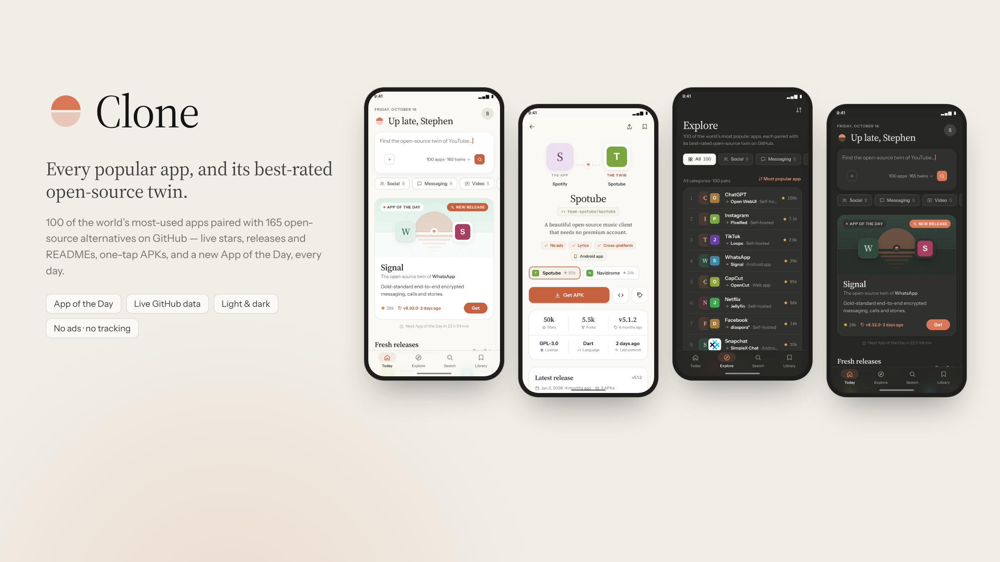

<p align="center"></p>

# Clone

**Every popular app, and its best-rated open-source twin.**

Clone is an Android app that puts the world's 100 most popular apps on one side of an *equator* and, on the other side, the best-rated open-source projects on GitHub that do the same job: YouTube ↔ NewPipe, Google Photos ↔ Immich, 1Password ↔ Bitwarden, WhatsApp ↔ Signal, and so on. Each twin comes with live GitHub stars, its latest release and notes, its README and screenshots. Where the project publishes one, you can install the APK with one tap. It's designed in Claude's warm ivory-and-terracotta style, in both light and dark mode.

## Features

- **App of the Day.** Every day the Today screen features one installable twin, favouring projects that just shipped a new release. You can turn on a daily notification at a time you pick. Picks are planned a week ahead, so the notification and the app always agree.
- **Fresh releases, Rising and New on GitHub.** Twins that shipped new versions, twins gaining the most stars this week, and brand-new Android apps created on GitHub, ranked by stars.
- **The Equator.** 100 popular apps across 17 categories, paired with 165 twins (1–3 per app, best first). You can filter, sort by popularity, stars, freshness or name, and search everything instantly. A GitHub-wide search covers anything that isn't in the catalog.
- **Twin detail.** A side-by-side comparison, stars, forks, licence, language, last commit, screenshots, the latest release notes, the README, other twins, and more in the same category.
- **One-tap installs.** Clone picks the right APK for your phone's CPU from the latest GitHub release and downloads it with Android's download manager. It then hands the file to the system installer and shows progress on the button.
- **Library.** Saved twins, with "updated since you saved" badges, history, and suggestions.
- **Live data with an offline snapshot.** A bundled snapshot means the app works with no network. Live data is fetched in batches through the GitHub search API, with ETag caching and rate-limit tracking. An optional token raises the limit from 60 to 5,000 requests an hour.
- **Native feel.** Edge-to-edge layout on every Android version from 7 to 15, light and dark system bars, an animated splash, predictive back, haptics, the share sheet and app shortcuts. It also has pull to refresh, swipe-to-dismiss sheets, long-press quick actions, shared-element tile transitions and a reduced-motion option.

## Install

Download `Clone-1.0.0.apk` from the Releases page (or the copy delivered alongside this source) and open it on your phone. Android will ask you to allow installs from your browser or file manager. Android 7.0 or newer is required.

## Project layout

```
app/src/main/
  AndroidManifest.xml
  java/app/clone/           Native shell (plain Java, no AndroidX)
    MainActivity.java       WebView host, edge-to-edge insets, system bars, back, splash hand-off
    AssetClient.java        Serves assets/ on https://appassets.androidplatform.net (secure origin)
    Bridge.java             window.CloneNative: haptics, share, downloads, notifications, theme…
    Downloads.java          DownloadManager + installer hand-off
    Daily.java              App of the Day alarm + notification
    DailyReceiver.java / BootReceiver.java
  res/                      Themes (light/dark, API 27/28/29/31), adaptive icon, splash, shortcuts
  assets/www/               The UI: vanilla ES modules, no build step
    index.html, css/app.css
    js/app.js               Shell: navigation stack, tabs, theme, native wiring
    js/data.js, github.js, aotd.js, store.js, ui.js, md.js, icons.js, native.js
    js/views/               today, explore, search, library, detail, settings, lists, onboarding
    data/catalog.json       Bundled catalog snapshot (generated)
    fonts/                  Source Serif 4, Instrument Sans, JetBrains Mono (OFL, subset)
data/
  catalog_src.py            The curated list: 100 apps → twins, taglines, perks
  build_catalog.py          Merges the list with GitHub stats → catalog.json
  refresh.sh                Re-reads all public GitHub data over git and rebuilds the snapshot
tools/
  build-apk.sh              Gradle-free build (aapt2 + javac + d8/dx + apksigner)
  zipalign.py               Minimal zipalign used by build-apk.sh
.github/workflows/
  build.yml                 Builds the APK on every push; publishes a release for v* tags
  refresh-catalog.yml       Weekly catalog refresh, committed automatically
```

## Build

### With Gradle (recommended)

Requirements: JDK 17 and the Android SDK (API 35). Android Studio covers both.

```bash
./gradlew assembleRelease          # → app/build/outputs/apk/release/
```

Without signing variables the release build is signed with the debug key. To sign with your own key:

```bash
export CLONE_KEYSTORE=/path/to/clone-release.p12
export CLONE_KEYSTORE_PASSWORD=…   # the .p12 uses the same password for store and key
export CLONE_KEY_ALIAS=clone
./gradlew assembleRelease
```

### Without Gradle

`tools/build-apk.sh` builds the same APK directly from SDK tools. This is how the prebuilt APK was made. Run the script to see which environment variables it needs.

## Deploy on GitHub

1. Create a repository and push this folder to it (`git init && git add . && git commit -m "Clone 1.0" && git push`).
2. In **Settings → Secrets and variables → Actions**, add these secrets:
   - `CLONE_KEYSTORE_BASE64`: `base64 -w0 clone-release.p12`
   - `CLONE_KEYSTORE_PASSWORD`
   - `CLONE_KEY_ALIAS` (`clone`)
   - `CLONE_KEY_PASSWORD` (same as the store password)

   Use the **same key that signed the prebuilt APK**, so installed copies can update in place.
3. Push a tag such as `git tag v1.0.1 && git push --tags`. The **Build APK** workflow builds and signs the APK and attaches it to a GitHub Release.
4. **Refresh catalog snapshot** runs every Monday (or on demand) and commits fresh stars, releases and icons.

Keep the keystore and its password out of the repository. `.gitignore` already excludes `*.p12`, `*.jks` and `signing/`.

## Data and privacy

- No accounts, analytics or ads. Library, history and settings stay on the device, and backups are disabled because the optional token lives in app storage.
- Network access goes to `api.github.com` for live data, and to GitHub's image and release hosts for icons, screenshots and APKs.
- The bundled snapshot is built from public data only: [EvanLi/Github-Ranking](https://github.com/EvanLi/Github-Ranking), [awesome-selfhosted-data](https://github.com/awesome-selfhosted/awesome-selfhosted-data), and each twin's own git repository (tags, default branch, fastlane metadata).
- App names are trademarks of their owners. They're used only to describe what each open-source project is an alternative to. Clone isn't affiliated with any of them, and every twin is an independent project.

## Licence

Clone is released under the MIT licence (see `LICENSE`). The fonts are under the SIL Open Font License 1.1 (`app/src/main/assets/www/fonts/licenses/`).
